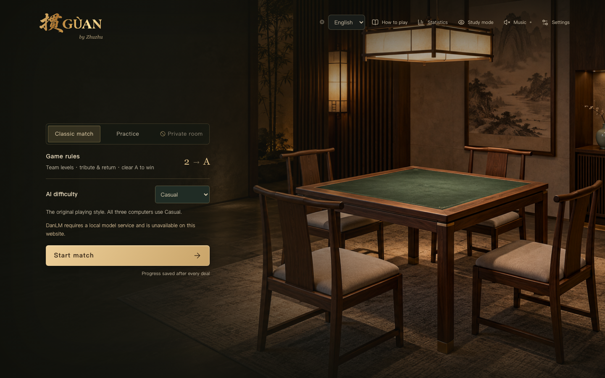

# GUAN · International Edition

[Play in your browser](https://jwxxc.github.io/guan-international/) · [简体中文](README.zh-CN.md)

Guandan is a four-player partnership card game played with two decks. GUAN brings it to a quiet private club: green felt, warm light, and a partner across the table.

This is an independent web sharing edition. **English is the default**; switch to **中文** on the home screen or in Settings. Your language choice is remembered, and switching during a paused game preserves your cards and progress.



- **Classic match:** teams advance from 2 to A, with tribute, returns and full match replays.
- **Practice:** play one deal with a level rank of your choice.
- **Four browser AI choices:** Casual, Balanced, Balanced Plus and Balanced Pro. The experimental names do not imply proven strength rankings.
- **Hand tools:** drag selection, movable columns, auto arrangement, straight detection, three layouts and undo.
- **Local records:** saved games, personal statistics, analysis archives and replays.
- **Seven music tracks**, sound controls and reduced motion.

Use a desktop or laptop browser; a viewport at least 1024 pixels wide is recommended. No account or installation is needed. The game and computer players run in your browser. Saved data stays in this browser at this website and does not automatically sync between devices. Clearing website data removes those saves.

DanLM, its hints and new DanLM study sessions require a local model service and are unavailable on GitHub Pages. The retained DanLM entry is explicitly disabled. Private multiplayer rooms and automatic learning also require services that this static website does not host. Sharing the link gives each visitor their own local game.

## Controls

Click a card to select it, or drag across cards. Double-click selects the same rank. Click **Play** to submit; releasing a drag never plays cards. Hold briefly before dragging to rearrange a column, or use Alt-drag. **Clear** cancels selection. With the hand focused, Enter plays, P passes and Esc clears. Leading a new trick cannot be passed.

Read **How to play** in the game for the complete bilingual house rules. Historical journals retain their original rule and AI identities.

## Run from source

Use Node.js 22.12 or newer and pnpm 11.19.0.

```sh
pnpm install --frozen-lockfile
pnpm dev
```

Open the local address printed by Vite (normally `http://127.0.0.1:5191`). This starts only the independent static web edition.

```sh
pnpm test
pnpm exec playwright install chromium webkit
pnpm test:e2e
pnpm build
pnpm preview
```

The release regression suite covers rules, deterministic games, saves, exchanges, hand arrangement, replay and localization. Browser tests cover English defaults, remembered Chinese selection, live language switching, save preservation, results and layouts. The production build has no development fixture controls.

GitHub Actions tests the source and deploys `dist` with `/guan-international/` as its base path. To build for that subpath locally, run `GUAN_BASE_PATH=/guan-international/ pnpm build`.

This repository excludes the original workspace’s apps, personal games, research exports, local services and private DanLM weights. See [edition notes](docs/INTERNATIONAL_EDITION.md) and [third-party notices](THIRD_PARTY_NOTICES.md).
